# 🗄️ 데이터베이스 - DB와 SQL 기본 문법

## 목차

- [1. 데이터베이스와 DBMS](#데이터베이스와-dbms)
  - [1.1 데이터베이스의 정의](#데이터베이스는-데이터-그-자체입니다)
  - [1.2 데이터베이스를 관리하는 DBMS](#데이터베이스를-관리하는-dbms)
- [2. DBMS의 종류](#dbms의-종류)
  - [2.1 표로 저장하는 RDBMS](#표로-저장하는-rdbms)
  - [2.2 NoSQL](#nosql)
  - [2.3 MySQL과 PostgreSQL](#mysql과-postgresql)
- [3. 테이블의 구성](#테이블의-구성)
  - [3.1 행(Row) / 레코드(Record)](#행row--레코드record)
  - [3.2 열(Column) / 속성(Attribute)](#열column--속성attribute)
- [4. SQL 명령어의 분류](#sql-명령어의-분류)
  - [4.1 DDL, DML, DCL](#ddl-dml-dcl)
- [5. 데이터를 조작하는 DML](#데이터를-조작하는-dml)
  - [5.1 INSERT](#insert)
  - [5.2 UPDATE](#update)
  - [5.3 DELETE](#delete)
- [6. SQL 기본 문법](#sql-기본-문법)
  - [6.1 SELECT 와 FROM](#select-와-from)
  - [6.2 WHERE](#where)
- [7. 묶어서 보고, 정렬해서 보기](#묶어서-보고-정렬해서-보기)
  - [7.1 GROUP BY](#group-by)
  - [7.2 HAVING](#having)
  - [7.3 ORDER BY](#order-by)
  - [7.4 작성 순서와 실행 순서](#작성-순서와-실행-순서)
- [8. JOIN](#join)
  - [8.1 테이블을 나누는 이유](#테이블을-나누는-이유)
  - [8.2 INNER JOIN](#inner-join)
  - [8.3 나머지 조인은 과제입니다](#나머지-조인은-과제입니다)
- [9. 전체 정리](#전체-정리)
  - [9.1 명령어 한눈에 보기](#명령어-한눈에-보기)
- [10. JPA](#jpa)
  - [10.1 JPA는 무엇인가요](#jpa는-무엇인가요)
  - [10.2 SQL을 직접 쓰면 생기는 일](#sql을-직접-쓰면-생기는-일)
  - [10.3 그래서 나온게 ORM입니다](#그래서-나온게-orm입니다)
  - [10.4 JPA와 ORM의 관계](#jpa와-orm의-관계)
  - [10.5 JPA의 동작 과정](#jpa의-동작-과정)
  - [10.6 Hibernate가 매핑하는 방법](#hibernate가-매핑하는-방법)
  - [10.7 JPA의 장점](#jpa의-장점)
  - [10.8 트랜잭션이란?](#트랜잭션이란)
- [11. JPA 활용해보기](#jpa-활용해보기)
  - [11.1 @Entity](#entity)
  - [11.2 @Table](#table)
  - [11.3 @Id](#id)
  - [11.4 @GeneratedValue](#generatedvalue)
  - [11.5 @Column](#column)
  - [11.6 @OneToMany 와 @ManyToOne](#onetomany-와-manytoone)
- [12. 실습해보기](#실습해보기)
  - [12.1 MySQL 접속하기](#mysql-접속하기)
  - [12.2 스키마 만들기](#스키마-만들기)
  - [12.3 프로젝트 만들기](#프로젝트-만들기)
  - [12.4 의존성 추가하기](#의존성-추가하기)
  - [12.5 DB 연결 정보 적기](#db-연결-정보-적기)
  - [12.6 ddl-auto 옵션](#ddl-auto-옵션)
  - [12.7 환경변수 넣기](#환경변수-넣기)
  - [12.8 최종 구조](#최종-구조)
- [13. 코드 작성해보기](#코드-작성해보기)
  - [13.1 Domain 만들기](#domain-만들기)
  - [13.2 Repository 만들기](#repository-만들기)
  - [13.3 DTO 만들기](#dto-만들기)
  - [13.4 Service 만들기](#service-만들기)
  - [13.5 Controller 만들기](#controller-만들기)
  - [13.6 포스트맨으로 테스트하기](#포스트맨으로-테스트하기)

---


# 데이터베이스와 DBMS

데이터베이스에 대한 정의부터 알아보겠습니다

## 데이터베이스는 데이터 그 자체입니다

먼저 데이터베이스(DB)는 정리된 상태로 보관된 데이터 그 자체를 말합니다

## 데이터베이스를 관리하는 DBMS

그리고 이런 데이터베이스를 생성,관리,제어하는 소프트웨어가 DBMS(DataBase Management System) 입니다

이 DBMS를 통해서 사용자는 데이터를 검색,삽입,수정,삭제를 할 수 있다고 아시면 됩니다

우리가 흔히 "MySQL 깔았어" 라고 말할때의 그 MySQL이 바로 이 DBMS입니다

**정리하면 데이터는 데이터베이스에 들어있고, 그 데이터를 대신 관리해주는 프로그램이 DBMS입니다**

---


# DBMS의 종류

이런 DBMS의 종류는 RDBMS, NoSQL이 있습니다

## 표로 저장하는 RDBMS

RDBMS는 데이터를 행과 열로 이루어진 테이블로 저장합니다

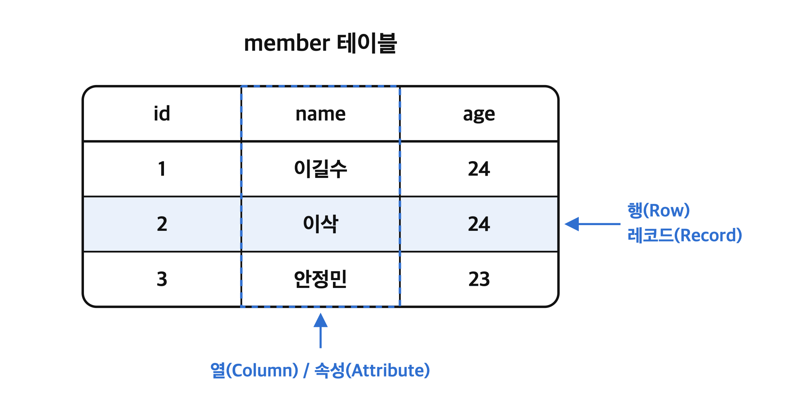

## NoSQL

NoSQL은 이름 그대로 테이블 형태를 고집하지 않는 DBMS입니다

열을 미리 정해두지 않아도 되니까 자유롭지만, 대신 데이터 구조가 제각각이어도 아무도 막아주지 않습니다

## MySQL과 PostgreSQL

이런 형태를 우리가 가장 흔히 보는 MySQL,PostgreSQL에서 볼 수 있습니다

요즘은 ai 서비스가 늘면서 구조가 고정되지 않은 JSON 데이터를 많이 다루는데, PostgreSQL은 JSON 데이터를 NoSQL처럼 유연하게 다룰 수 있어서 많이 쓰인다고 합니다

**정리하면 구조가 정해져 있으면 RDBMS, 구조가 계속 바뀌면 NoSQL이 편하다고 보시면 됩니다**

스터디에서는 계속 RDBMS 기준으로 진행하겠습니다

---


# 테이블의 구성

앞에서 본 테이블 그림을 조금만 더 뜯어보겠습니다

## 행(Row) / 레코드(Record)

테이블에서 가로 방향으로 저장된 데이터 단위입니다

데이터가 출력될 때, 행단위로 나옵니다

그림에서 파랗게 칠해진 `2, 이삭 ,24` 가 행 하나라고 보시면 됩니다

## 열(Column) / 속성(Attribute)

세로 방향으로, 어떤 데이터를 담을지 미리 정해둔 자리입니다

그림에서 점선으로 표시한 `name`이 열 하나이고, 여기에는 이름만 들어가게 됩니다

열은 타입이 정해져 있어서 `age` 열에 `"스물넷"` 같은 문자를 넣으려고 하면 오류가 납니다

1주차에서 봤던 타입안정성이 여기서도 그대로 적용된다고 보시면 됩니다

---


# SQL 명령어의 분류

이 테이블을 다루는 언어가 SQL이고, SQL은 하는 일에 따라 세가지로 나뉩니다

## DDL, DML, DCL

**DDL(Data Definition Language)**

테이블 자체를 만들고 바꾸는 명령어입니다 (`CREATE`, `ALTER`, `DROP`)

**DML(Data Manipulation Language)**

저장된 데이터에 대한 조작을 하는 명령어이고, 가장 많이 사용하게 될 명령어입니다 (`INSERT`, `UPDATE`, `DELETE`, `SELECT`)

**DCL(Data Control Language)**

누가 이 데이터를 건드릴 수 있는지 권한을 주고 뺏는 명령어입니다 (`GRANT`, `REVOKE`)

---


# 데이터를 조작하는 DML

앞에서 본 `member` 테이블을 그대로 가지고 예시를 들어보겠습니다

## INSERT

테이블에 행을 삽입할 때, 사용하는 명령어입니다

```sql
INSERT INTO member (id, name, age)
VALUES (4, '김서령', 20);
```

`INTO` 뒤에 어느 테이블인지, 괄호 안에 어느 열에 넣을지, `VALUES` 뒤에 실제 값을 적어주면 됩니다

여기서 문자열은 작은따옴표로 감싸야 하고, 숫자는 그냥 적어주시면 됩니다

## UPDATE

테이블에 저장된 데이터를 수정할 때 사용하는 명령어입니다

방금 넣은 서령님의 나이를 30으로 고쳐보겠습니다

```sql
UPDATE member SET age = 30 WHERE id = 4;
```

`SET` 뒤에 무엇을 바꿀지, `WHERE` 뒤에 어느 행을 바꿀지 적어줍니다

만약 여기서 `WHERE`를 빼먹으면 누구의 나이를 바꿔야할지 모르기 때문에 모든 행(id)의 나이가 30으로 바뀌어버립니다

## DELETE

테이블에 저장된 데이터를 행 단위로 삭제할 때 사용하는 명령어입니다

```sql
DELETE FROM member WHERE id = 5;
```

행 단위라서, 열 하나만 골라서 지우는건 불가능합니다

값 하나만 비우고 싶으시면 `DELETE`가 아니라 `UPDATE`로 그 자리에 `NULL`을 넣어주면 됩니다

**여기서도** `WHERE`**를 빼먹으면 테이블의 모든 행이 지워지기 때문에,** `UPDATE`**와** `DELETE`**는** `WHERE`**를 붙였는지 꼭 확인하고 실행하셔야 합니다**

---


# SQL 기본 문법

이제 데이터를 꺼내보는 `SELECT`를 보겠습니다

## SELECT 와 FROM

`SELECT`는 데이터 조회를 하는 명령어이고, `FROM`은 데이터를 꺼낼 테이블을 말합니다.

```sql
SELECT name, age FROM member;
```

`SELECT` 뒤에는 조회할 열을 적어주고, 전부 다 보고 싶으면 `*`를 적어주면 됩니다

```sql
SELECT * FROM member;
```


| id  | name | age |
| --- | ---- | --- |
| 1   | 이길수  | 24  |
| 2   | 이삭   | 24  |
| 3   | 안정민  | 23  |
| 4   | 김서령  | 20  |


보다시피 테이블에 있는 4개의 행이 전부 나온걸 확인할 수 있습니다

## WHERE

조건에 맞는 행만 골라내는 자리입니다

```sql
SELECT name, age FROM member WHERE age >= 24;
```


| name | age |
| ---- | --- |
| 이삭   | 24  |
| 이길수  | 24  |


나이가 24 이상인 행만 남은걸 볼 수 있습니다

조건에는 아래와 같은 것들을 쓸 수 있습니다


| 연산자                      | 설명                   |
| ------------------------ | -------------------- |
| `=`                      | 같은 값을 찾습니다           |
| `!=` 또는 `<>`             | 다른 값을 찾습니다           |
| `>`, `<`, `>=`, `<=`     | 크거나 작은 값을 찾습니다       |
| `BETWEEN a AND b`        | a 이상 b 이하인 값을 찾습니다   |
| `IN (a, b, c)`           | 나열한 값들 중 하나인 값을 찾습니다 |
| `LIKE '김%'`              | `김`으로 시작하는 값을 찾습니다   |
| `IS NULL`, `IS NOT NULL` | 값이 비어있는지 여부로 찾습니다    |
| `AND`, `OR`, `NOT`       | 조건을 여러개 묶어줍니다        |


여기서 `NULL`은 값이 아직 없다는 뜻인데, `= NULL`이 아니라 `IS NULL`로 비교해야 한다는 점만 알아두시면 좋습니다

---


# 묶어서 보고, 정렬해서 보기


## GROUP BY

같은 값을 가진 행들을 하나로 묶어주는 자리입니다

`member` 테이블을 보면 이길수와 이삭이 둘 다 `24`살인걸 확인할 수 있습니다

이 테이블로 나이별로 몇 명인지 세보겠습니다

```sql
SELECT age, COUNT(*) FROM member GROUP BY age;
```


| age | `COUNT(*)` |
| --- | ---------- |
| 24  | 2          |
| 23  | 1          |
| 20  | 1          |


4개였던 행이 나이별로 묶여서 3개가 된걸 확인할 수 있습니다

이렇게 묶은 그룹에 대해서 `COUNT`(개수), `SUM`(합계), `AVG`(평균), `MAX`(최댓값), `MIN`(최솟값) 같은 집계함수를 쓸 수 있습니다

## HAVING

group by로 묶고 난 결과에다가 조건을 거는 자리입니다. group by와 세트라고 생각하시면 편합니다

```sql
SELECT age, COUNT(*) FROM member GROUP BY age HAVING COUNT(*) >= 2;
```


| age | `COUNT(*)` |
| --- | ---------- |
| 24  | 2          |


2명 이상인 나이만 남기라고 했더니 `24`살 그룹만 남은걸 확인할 수 있습니다

`WHERE`랑 뭐가 다른지 헷갈리실텐데, `WHERE`는 묶기 전의 행에 거는 조건이고 `HAVING`은 group by로 묶은 다음의 그룹에 거는 조건입니다.

그렇다면 실행순서는 `WHERE` 이 `GROUP BY` 보다 빠르겠죠?

## ORDER BY

결과를 정렬하는 자리입니다

```sql
SELECT name, age FROM member ORDER BY age DESC;
```


| name | age |
| ---- | --- |
| 이길수  | 24  |
| 이삭   | 24  |
| 안정민  | 23  |
| 김서령  | 20  |


나이가 큰 순서대로 줄세워진걸 확인할 수 있습니다

`ASC`는 오름차순, `DESC`는 내림차순이고 아무것도 안 적으면 오름차순이 기본값입니다

## 작성 순서와 실행 순서

지금까지 본 자리들을 순서대로 적으면 이렇게 됩니다

```sql
SELECT   age, COUNT(*)
FROM     member
WHERE    age >= 20
GROUP BY age
HAVING   COUNT(*) >= 2
ORDER BY age DESC;
```

**실행 순서는** `FROM` **→** `WHERE` **→** `GROUP BY` **→** `HAVING` **→** `SELECT` **→** `ORDER BY` **입니다**

---


# JOIN


## 테이블을 나누는 이유

회원 정보와 회원이 쓴 글을 한 테이블에 다 넣는다고 생각해보겠습니다

그러면 삭님이 글을 10개 쓸때마다 이름과 나이가 10번 중복해서 저장되겠죠?

그래서 회원은 `member`테이블,  글은 `post` 테이블로 나누고, `post`에는 누가 썼는지 알 수 있게 `member_id`만 들고있게 만듭니다 

아래는 `post` 테이블입니다


| member_id | title  |
| --------- | ------ |
| 2         | 자바 정리  |
| 2         | SQL 정리 |
| 3         | DB 정리  |


`member_id`는 이 글을 누가 썼는지를 나타내고, `2`번인 삭님이 글을 두개 쓴걸 확인할 수 있습니다

이렇게 나눠둔 테이블을 다시 하나로 붙여서 보는게 JOIN입니다

## INNER JOIN

`INNER JOIN`은 양쪽 테이블에 모두 있는 데이터만 남기는 조인입니다

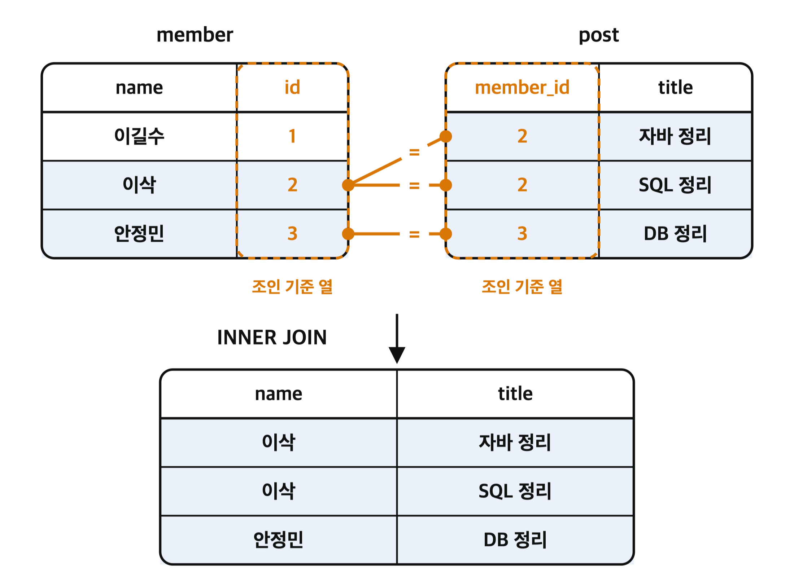

그림에서 주황 점선으로 표시한 `id`와 `member_id`가 두 테이블을 이어주는 기준이 되는 열입니다

이 두 열의 값이 같은 것끼리 주황 선으로 이어진걸 확인할 수 있습니다

`2`번인 삭님은 글이 두개라서 `자바 정리`,`SQL 정리` 두 줄과 이어졌고, `3`번인 정민님은 `DB 정리`와 이어졌습니다

**하지만 길수님은 쓴 글이 없어서 이어질 짝이 없고, 그래서 결과에서 빠져버립니다**

이걸 SQL로 적으면 이렇게 됩니다

```sql
SELECT member.name, post.title
FROM member
INNER JOIN post ON member.id = post.member_id;
```


| name | title  |
| ---- | ------ |
| 이삭   | 자바 정리  |
| 이삭   | SQL 정리 |
| 안정민  | DB 정리  |


여기서 이삭이 두 번 나오는건, 글이 두개라서 글마다 한 줄씩 만들어졌기 때문입니다

`ON` 뒤에는 두 테이블을 어떤 기준으로 이을지 적어주면 됩니다

그리고 테이블 이름을 매번 적기 귀찮으면 별칭(as)을 붙여서 짧게 쓸 수 있습니다. 

```sql
SELECT m.name, p.title
FROM member m
INNER JOIN post p ON m.id = p.member_id;
```

참고로 `INNER`를 생략하고 `JOIN`만 적어도 똑같이 동작합니다

## 나머지 조인은 과제입니다

조인에는 `INNER JOIN` 말고도 `OUTER JOIN`, `NATURAL JOIN` 등등 더 있습니다

시간상 다 다루지는 못했으니, [SQL JOIN 총정리](https://velog.io/@wjpark4430/SQL-JOIN-총정리-INNER-OUTER-CROSS-SELF-JOIN) 글로 나머지 조인을 따로 공부해보시는걸 추천합니다!

---


# 전체 정리


## 명령어 한눈에 보기

지금까지 본 명령어들을 표로 정리해봤습니다


| 명령어          | 하는 일               | 예시                                              |
| ------------ | ------------------ | ----------------------------------------------- |
| `INSERT`     | 행을 넣습니다            | `INSERT INTO member ... VALUES ...`             |
| `UPDATE`     | 저장된 값을 바꿉니다        | `UPDATE member SET age = 30 WHERE id = 4`       |
| `DELETE`     | 행을 지웁니다            | `DELETE FROM member WHERE id = 5`               |
| `SELECT`     | 어느 열을 볼지 고릅니다      | `SELECT name, age`                              |
| `FROM`       | 어느 테이블에서 꺼낼지 고릅니다  | `FROM member`                                   |
| `WHERE`      | 묶기 전, 행에 조건을 겁니다   | `WHERE age >= 24`                               |
| `GROUP BY`   | 같은 값끼리 묶습니다        | `GROUP BY age`                                  |
| `HAVING`     | 묶은 다음, 그룹에 조건을 겁니다 | `HAVING COUNT(*) >= 2`                          |
| `ORDER BY`   | 결과를 정렬합니다          | `ORDER BY age DESC`                             |
| `INNER JOIN` | 양쪽에 다 있는 것만 붙입니다   | `INNER JOIN post ON member.id = post.member_id` |


---


# JPA

SQL은 여기까지 보고, 다음으론 JPA에 대해 이어서 알아보도록 하겠습니다

## JPA는 무엇인가요

JPA(Java Persistence API)는 자바 객체와 관계형 데이터베이스 테이블을 연결해서, SQL을 직접 많이 작성하지 않고 DB를 다룰 수 있게 해주는 기술입니다

정의를 알아보았으니 이걸 왜 사용하는지 알아봐야겠죠?

## SQL을 직접 쓰면 생기는 일

자바는 JDBC API를 통해 SQL을 데이터베이스에 전달합니다

여기서 JDBC API는 자바 프로그램이 관계형 데이터베이스와 통신할 수 있게 해주는 API라고 보시면 됩니다

하지만 JDBC를 직접 사용하면 개발자가 필요한 SQL을 직접 작성해야 하고, 요구사항이 변경될 때마다 SQL과 관련 코드도 함께 수정해야 합니다

예를 들어 처음에는 회원의 이름만 조회하면 되는 요구사항이었다고 해보겠습니다

```sql
-- 회원의 이름을 출력하는 요구사항
SELECT name FROM member;
```

그런데 나이도 같이 보여달라는 요청이 들어왔다면?

```sql
-- 여기서 나이도 같이 보여달라고 한다면....?
SELECT name, age FROM member;
```

여기서 끝나는게 아니라, 이 결과를 받아서 담아주던 자바 코드도 전부 같이 고쳐야 합니다

3주차때 했던 패키지 구조로 보면, `repository`에서 SQL을 직접 쓰는 코드는 대략 이렇게 생겼습니다

```java
// MemberRepository - JDBC로 직접 쓸 때
String sql = "SELECT name, age FROM member";        // ① SQL 문자열 수정
ResultSet rs = statement.executeQuery(sql);
while (rs.next()) {
    Member member = new Member();
    member.setName(rs.getString("name"));
    member.setAge(rs.getInt("age"));                 // ② 결과를 꺼내 담는 코드 추가
    members.add(member);
}
```

`Member`에 `age` 필드 하나를 추가했을 뿐인데, ①번 SQL 문자열과 ②번 결과를 꺼내 담는 코드까지 개발자가 직접 맞춰줘야 하는걸 볼 수 있습니다

**즉, 객체는 객체대로 SQL은 SQL대로 따로 관리하게 되어서, 한쪽이 바뀔 때마다 나머지 한쪽도 같이 고쳐야 하는 문제가 생깁니다**

## 그래서 나온게 ORM입니다

이렇게 자바의 객체와 관계형 데이터베이스의 테이블을 자동으로 연결해주는 기술을 ORM(Object-Relational Mapping)이라고 합니다

이름 그대로 객체(Object)와 관계형(Relational) 데이터를 매핑(Mapping)해준다는 뜻입니다

자바에서 ORM을 쓰게 해주는 JPA를 쓰면, 아까 그 `repository` 코드가 이렇게 바뀝니다

```java
// MemberRepository - JPA를 쓸 때
public interface MemberRepository extends JpaRepository<Member, Long> {
}   // 손댈게 없음
```

`Member`에 `age` 필드만 추가하면, JPA가 `SELECT name, age ...`를 알아서 만들고 결과도 `age`에 알아서 담아줍니다. 

## JPA와 ORM의 관계

ORM은 객체와 테이블을 연결해주는 기술의 이름이고, JPA는 자바에서 ORM을 어떻게 쓸지 정해둔 표준입니다

JPA는 이렇게 하자고 정해둔 인터페이스 모음이라서, 실제로 일을 하는 구현체가 따로 있는데 스프링에서 기본으로 쓰는게 Hibernate입니다

실습에서 `application.yml`에 적을 `hibernate` 설정도 바로 이 Hibernate에 대한 설정입니다

**즉, 우리는 JPA라는 표준에 맞춰 코드를 쓰고, 실제 매핑은 Hibernate가 해준다고 보시면 됩니다**

Hibernate가 어떻게 매핑하는지는 동작 과정을 먼저 보고 나서 살펴보겠습니다

## JPA의 동작 과정

그럼 JPA가 실제로 어떻게 동작하는지 그림으로 살펴보겠습니다

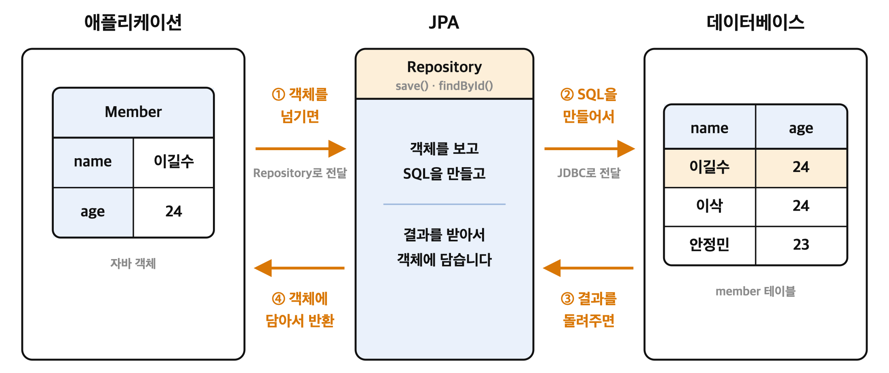

왼쪽에는 `Member` 객체가 있고, 오른쪽에는 DB에 저장되어 있는 `member` 테이블이 있습니다

가운데 JPA 맨 위에는 아까 본 `Repository`가 있는데, 우리 코드는 JPA를 직접 부르지 않고 `save()`, `findById()` 같은 `Repository`의 메서드를 통해 JPA에게 일을 맡깁니다

그림의 화살표를 번호 순서대로 따라가보겠습니다


| 단계  | 흐름           | 하는 일                                                                        |
| --- | ------------ | --------------------------------------------------------------------------- |
| ①   | 애플리케이션 → JPA | `memberRepository.save(member)`처럼 `Repository`를 통해 `Member` 객체를 JPA에게 넘겨줍니다 |
| ②   | JPA → DB     | JPA가 그 객체를 보고 SQL을 직접 만들어서, JDBC를 통해 DB로 보냅니다                               |
| ③   | DB → JPA     | DB가 SQL을 실행하고 그 결과를 JPA에게 돌려줍니다                                             |
| ④   | JPA → 애플리케이션 | JPA가 그 결과를 다시 `Member` 객체에 돌려줍니다                                            |


**여기서 중요한건 SQL이 오가는 ②번과 ③번을 우리가 직접 쓰지 않는다는 점입니다**

**우리는 객체만 다루고, SQL을 만들고 결과를 다시 객체로 바꾸는 일은 JPA가 대신 해준다고 보시면 됩니다**

여기서 ②번처럼 객체를 SQL로 바꾸고, ④번처럼 결과를 다시 객체로 바꾸는 일이 바로 앞에서 본 ORM의 매핑입니다

그래서 아까처럼 나이가 추가되어도, 객체에 필드만 추가해주면 SQL은 JPA가 알아서 다시 만들어줍니다

## Hibernate가 매핑하는 방법

그럼 ②번에서 어떤 SQL을 만들지, ④번에서 결과를 어느 필드에 담을지는 어떻게 아는걸까요?

그림에서 JPA라고 적어둔 가운데 부분에서 실제로 이 일을 하는게 Hibernate입니다

**먼저 애플리케이션을 켤 때 매핑 정보를 만들어 둡니다**

Hibernate는 애플리케이션이 켜질 때 `@Entity`가 붙은 클래스를 전부 찾아서, 클래스와 필드를 하나씩 읽어둡니다

```java
@Entity
public class Member {

    @Id
    @GeneratedValue(strategy = GenerationType.IDENTITY)
    private Long id;

    private String name;
    private int age;
}
```

어노테이션은 바로 뒤에서 하나씩 보니까, 지금은 이런 표시가 붙어있구나 정도로만 봐주시면 됩니다

이 클래스를 읽고 나면 Hibernate는 이런 짝을 기억해둡니다


| 자바           | DB                            |
| ------------ | ----------------------------- |
| `Member` 클래스 | `member` 테이블                  |
| `id` 필드      | `id` 열 (기본키, DB가 자동으로 번호를 매김) |
| `name` 필드    | `name` 열                      |
| `age` 필드     | `age` 열                       |


이 짝을 매핑 정보라고 하고, ②번과 ④번은 전부 이 표를 보고 움직입니다

**저장할 때는 객체를 SQL로 바꿉니다 (②번)**

```java
memberRepository.save(member);  // name = "이길수", age = 24 인 Member 객체
```

```sql
-- Hibernate가 매핑 정보를 보고 만든 SQL
insert into member (age, name) values (?, ?)
-- ? 자리에는 member 객체의 age 값 24, name 값 '이길수'가 차례대로 들어갑니다
```

`id`는 DB가 알아서 번호를 매겨주도록 해뒀기 때문에 SQL에서 빠져있는걸 볼 수 있습니다

**조회할 때는 결과를 다시 객체로 바꿉니다 (④번)**

```java
memberRepository.findById(1L);  // id가 1인 회원 조회
```

```sql
-- Hibernate가 매핑 정보를 보고 만든 SQL
select m1_0.id, m1_0.age, m1_0.name from member m1_0 where m1_0.id = ?
-- m1_0은 Hibernate가 member 테이블에 붙인 별칭입니다
```

DB가 결과 한 줄을 돌려주면, Hibernate는 먼저 매개변수가 없는 생성자로 빈 `Member` 객체를 만듭니다

그리고 매핑 정보를 보고 `id` 열 값은 `id` 필드에, `name` 열 값은 `name` 필드에, `age` 열 값은 `age` 필드에 채워 넣습니다

아까 JDBC 코드에서 우리가 `rs.getString("name")`으로 꺼내서 `member.setName()`에 직접 담던 부분을 Hibernate가 대신 해주는 셈입니다

이때 setter를 부르지 않고 필드에 바로 값을 넣기 때문에, 엔티티에 setter가 없어도 괜찮습니다

뒤에서 엔티티를 만들 때 `@NoArgsConstructor`를 꼭 붙이는데, Hibernate가 이렇게 빈 객체부터 만들기 때문입니다

실습에서 `show_sql: true`를 켜두면, 콘솔에 `Hibernate:`로 시작하는 줄로 이 SQL이 그대로 찍히는걸 확인할 수 있습니다

**그래서** `Member`**에 필드를 하나 추가하면 매핑 정보에 열이 하나 늘어나고, SQL에도 그 열이 알아서 붙게 됩니다**

## JPA의 장점

동작 과정을 봤으니, JPA를 쓰면 어떤 점이 좋은지 하나씩 정리해보겠습니다

먼저 한눈에 보면 이렇습니다


| 장점    | 한마디로                                 |
| ----- | ------------------------------------ |
| 생산성   | 반복되는 CRUD SQL을 직접 쓰지 않아도 됩니다         |
| 유지보수  | 객체에 필드만 고치면 SQL은 JPA가 다시 만들어줍니다      |
| 이식성   | DB를 바꿔도 코드는 그대로 둘 수 있습니다             |
| 지연 로딩 | 연관된 데이터는 실제로 쓰는 시점에 가져옵니다            |
| 트랜잭션  | 위 작업들을 하나로 묶어서 전부 성공하거나 전부 실패하게 해줍니다 |


**지연 로딩**

연관된 데이터를 처음부터 전부 꺼내오지 않고, 실제로 사용하는 시점에 조회합니다

회원 이름만 보고 싶은데 그 회원이 쓴 글 100개까지 같이 딸려오면 낭비겠죠?

뒤에서 코드를 작성할 때 나오는 `fetch = FetchType.LAZY`가 바로 이 지연 로딩을 쓰겠다는 뜻입니다

## 트랜잭션이란?

트랜잭션은 여러 작업을 하나로 묶어서, 전부 성공하거나 전부 실패하게 만들어주는 단위입니다

계좌이체를 하는데 출금은 됐고 입금이 실패하면 큰일나겠죠? 이걸 막아주는게 트랜잭션입니다

이것도 시간상 다루지 못했으니, [트랜잭션 간단 정리](https://velog.io/@daehwan0307/트랜잭션Transaction이란-간단-정리) 글을 보면서 `@Transactional` 과 함께 따로 공부해보시는걸 추천합니다!

---


# JPA 활용해보기

이제 자바 코드에서 JPA를 어떻게 쓰는지 보겠습니다

## @Entity

`@Entity`는 이 클래스가 DB 테이블과 연결되는 클래스라고 표시해주는 어노테이션입니다

이렇게 표시해둔 클래스를 엔티티(Entity)라고 부르고, JPA는 이 표시가 붙어있는 클래스만 관리해줍니다

```java
@Entity
public class Member {

    private String name;
    private int age;
}
```


## @Table

`@Table`은 클래스 이름과 실제 테이블 이름이 다를 때, 어느 테이블과 연결할지 직접 적어주는 어노테이션입니다

클래스 이름은 `Member`인데 DB에 있는 테이블 이름은 `user`라면 이렇게 적어줍니다

```java
@Entity
@Table(name = "user")
public class Member {
    ...
}
```

**그럼 이름을 같게 한다면 굳이 안써도 되겠죠?**

```java
@Entity // 클래스 이름이 Member라서 member 테이블과 자동으로 연결됩니다
public class Member {
    ...
}
```

클래스 이름과 테이블 이름이 같으면 `@Table`은 생략하셔도 됩니다

## @Id

`@Id`는 이 필드가 테이블의 기본키(Primary Key)라고 표시해주는 어노테이션입니다

기본키는 행 하나하나를 구분해주는 값이고, `member` 테이블에서는 `id` 열이 그 역할을 하고 있었습니다

엔티티에는 `@Id`가 반드시 하나 있어야 하고, JPA는 이 값으로 어느 행인지를 찾아갑니다

```java
@Id
@GeneratedValue(strategy = GenerationType.IDENTITY)
private Long id;
```

그런데 이렇게만 적어두면 `id` 값을 우리가 직접 넣어줘야 합니다

## @GeneratedValue

그래서 기본키를 자동으로 만들어달라고 맡기는게 `@GeneratedValue`입니다

번호를 누가 만들어주냐에 따라 전략이 나뉘는데,  자주 쓰게될 두가지만 보겠습니다


| 전략         | ID를 만드는 곳                  | 주로 쓰는 DB           |
| ---------- | -------------------------- | ------------------ |
| `IDENTITY` | DB의 `auto_increment`에 맡깁니다 | MySQL              |
| `SEQUENCE` | DB의 시퀀스에서 번호를 받아옵니다        | PostgreSQL, Oracle |


**MySQL을 쓰신다면** `IDENTITY`**, PostgreSQL이나 Oracle을 쓰신다면** `SEQUENCE`**라고 기억하시면 됩니다**

이 외에 `TABLE`, `AUTO` 전략도 있지만 거의 쓰지 않으니, 위의 두가지만 알고 계셔도 충분합니다

## @Column

`@Column`은 필드와 연결될 열의 이름이나 조건을 직접 정해주는 어노테이션입니다

```java
@Column(name = "userName", nullable = false, length = 20)
private String name;
```


| 속성         | 하는 일              | 예시                   |
| ---------- | ----------------- | -------------------- |
| `name`     | 연결할 열의 이름을 정합니다   | `name = "user_name"` |
| `nullable` | 값이 비어있어도 되는지 정합니다 | `nullable = false`   |
| `length`   | 문자열의 최대 길이를 정합니다  | `length = 20`        |


`@Table`과 마찬가지로 필드 이름과 열 이름이 같으면 `@Column`도 생략할 수 있습니다

Spring Boot 기본 설정에서는 userName이 user_name처럼 카멜케이스에서 스네이크케이스로 변환됩니다.

## @OneToMany 와 @ManyToOne

JOIN에서 봤던 회원과 글의 관계를 다시 가져와보겠습니다

한명이 `자바 정리`, `SQL 정리` 두개의 글을 썼다고 하면, 회원 한명(One)에 글 여러개(Many)가 붙는 관계가 됩니다

이걸 어느 쪽 입장에서 보느냐에 따라 부르는 이름이 달라집니다

$\color{#9A6A3A}\textsf{@ManyToOne}$

글 여러개(Many)가 회원 한명(One)을 바라보는 쪽이고, 외래키를 들고있는 쪽입니다

```java
// Post 클래스
@ManyToOne
@JoinColumn(name = "member_id")
private Member member;
```

`@JoinColumn`에는 어느 열이 외래키인지를 적어주는데, `post` 테이블이 들고 있던 그 `member_id`가 들어갑니다

여기서 외래키(Foreign Key)는 다른 테이블의 기본키를 가리키는 열입니다

`post`의 `member_id`에는 `member` 테이블의 기본키인 `id` 값이 들어가 있어서, 이 값만 보고도 글을 쓴 회원이 누구인지 찾아갈 수 있습니다

$\color{#9A6A3A}\textsf{@OneToMany}$

반대로 회원 한명(One)이 글 여러개(Many)를 들고있는 쪽이고, 그림의 `posts` 리스트가 이 부분입니다

```java
// Member 클래스
@OneToMany(mappedBy = "member")
private List<Post> posts = new ArrayList<>();
```

`mappedBy`에는 상대방인 `Post`에서 나를 가리키고 있는 필드의 이름을 적어줍니다

**외래키를 실제로 들고있는 쪽은 항상** `@ManyToOne`**이 붙은 쪽이라는 점만 기억하시면 됩니다**

---

# 실습해보기

지금까지 본 내용을 직접 돌려보겠습니다

여기서 + 버튼을 눌러서 erd를 생성합니다


JPAExample 이라는 이름의 erd 를 만듭니다

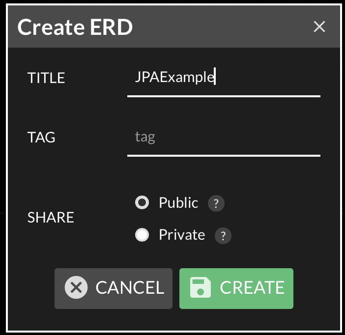

여기서 Import 를 누릅니다

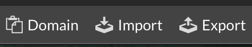

아래 SQL을 그대로 붙여넣어줍니다

```sql
CREATE TABLE course (
    id          BIGINT       NOT NULL AUTO_INCREMENT,
    course_name VARCHAR(255) NOT NULL,
    professor   VARCHAR(255),
    PRIMARY KEY (id)
);

CREATE TABLE student (
    id        BIGINT       NOT NULL AUTO_INCREMENT,
    name      VARCHAR(255) NOT NULL,
    major     VARCHAR(255),
    course_id BIGINT,
    PRIMARY KEY (id),
    FOREIGN KEY (course_id) REFERENCES course (id)
);
```


그리고 import 버튼을 눌러주신다면...

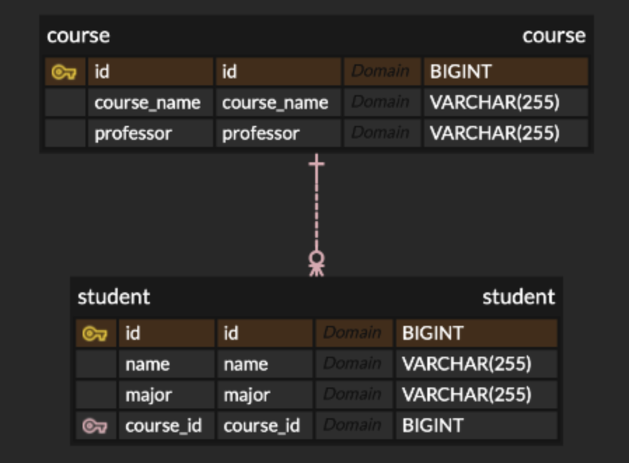

붙여넣기만 했는데 `course`와 `student` 테이블이 자동으로 그려지고, 둘 사이에 관계선까지 이어지는걸 볼 수 있습니다

`student`의 `course_id`가 `course`의 `id`를 가리키도록 외래키를 걸어뒀기 때문에, 강의 하나에 학생 여러명이 붙는 관계로 그려집니다

erd에 대해서 더 궁금하신 분은 [ERD 사용법](https://cinnamonlover.tistory.com/entry/ERD-사용법-미완성) 글을 참고해주시면 됩니다

## MySQL 접속하기

MySQL Workbench를 켜고 `Local instance 3306`을 눌러줍니다

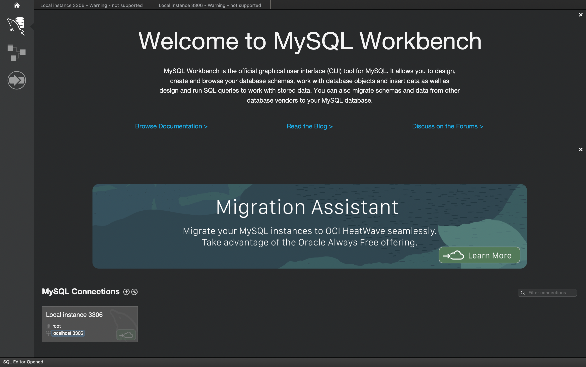

설치할 때 정했던 비밀번호를 입력하면 접속됩니다

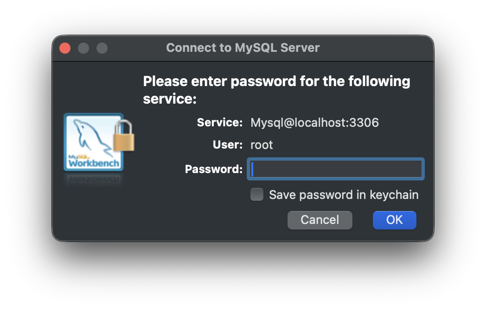

## 스키마 만들기

쿼리창에 아래를 적고 실행해서, 실습에서 사용할 스키마를 하나 만들어줍니다

- **Mac:** `Command(⌘) + T`
- **Windows:** `Ctrl + T`

아래 명령어를 눌러주시면 됩니다

```sql
CREATE DATABASE student_db;
```

적었으면 `alt + enter`를 눌러서 실행해줍니다

여기서 정한 이름이 조금 뒤에 나올 `DB_URL`의 맨 뒤에 들어갑니다

## 프로젝트 만들기

IntelliJ에서 `New Project` → `Spring Boot`를 골라주고, 아래와 같이 맞춰줍니다

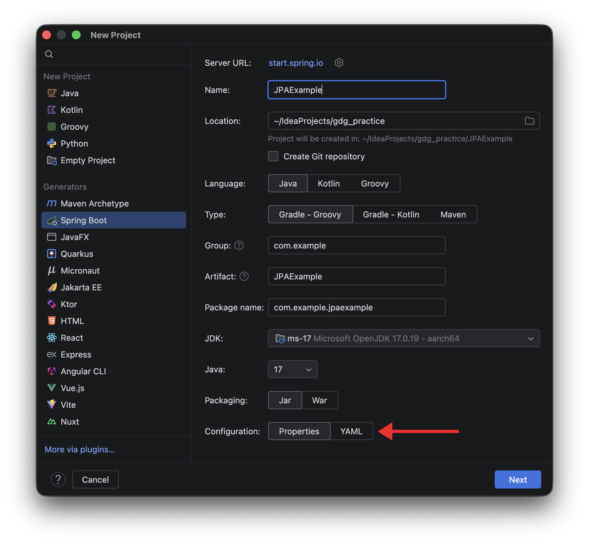

Configuration 이 기본적으로 Properties라고 설정되어있을텐데 이걸 YAML으로 바꿔줍니다!

## 의존성 추가하기

`Lombok`, `Spring Web`, `Spring Data JPA`, `MySQL Driver` 네개를 추가해줍니다

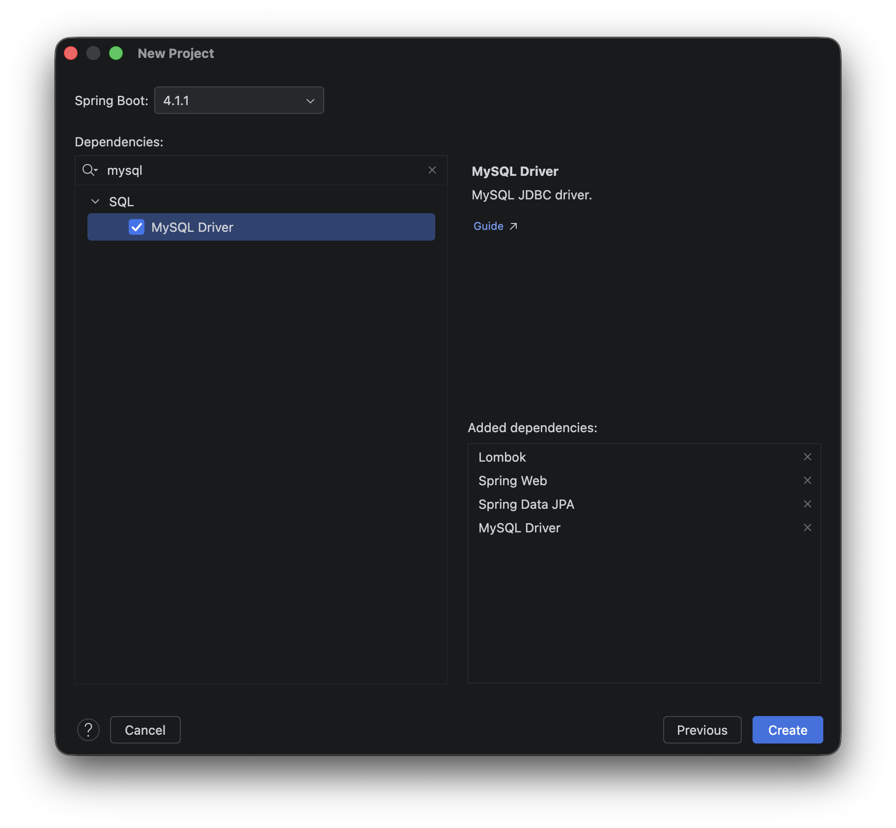

## DB 연결 정보 적기

바꾼 `application.yml`에 DB 접속 정보를 적어줍니다

```yaml
spring:
  datasource:
    url: ${DB_URL}
    username: ${DB_USER_NAME}
    password: ${DB_PASSWORD}
    driver-class-name: com.mysql.cj.jdbc.Driver

  jpa:
    hibernate:
      ddl-auto: create
    properties:
      hibernate:
        show_sql: true
        format_sql: true
    open-in-view: false
```

주소와 비밀번호를 그대로 적으면 깃허브에 그대로 올라가기 때문에, `${}`로 적어두고 값은 환경변수로 넣어주겠습니다

## ddl-auto 옵션

`ddl-auto`는 애플리케이션을 켤 때 테이블을 어떻게 할지 정해주는 값입니다


| 값             | 하는 일                                        |
| ------------- | ------------------------------------------- |
| `create`      | 엔티티와 매핑되는 테이블을 자동으로 만들고, 이미 있으면 지우고 다시 만듭니다 |
| `create-drop` | `create`와 같지만, 애플리케이션이 종료될 때 테이블을 삭제합니다     |
| `update`      | 테이블을 자동으로 만들되, 이미 있으면 바뀐 열만 변경합니다           |
| `validate`    | 엔티티 클래스와 테이블이 정상적으로 매핑되는지 검사만 합니다           |
| `none`        | 아무 일도 일어나지 않습니다                             |


`create`**는 켤 때마다 테이블을 지우고 다시 만들기 때문에, 데이터가 남아야 하는 곳에서는 절대 쓰시면 안됩니다**

## 환경변수 넣기

실행 구성을 눌러서 `Edit Configurations`로 들어갑니다

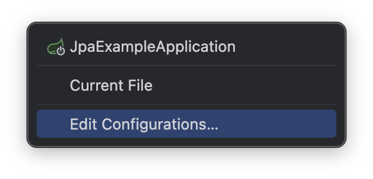

`Modify options` → `Environment variables`를 눌러줍니다

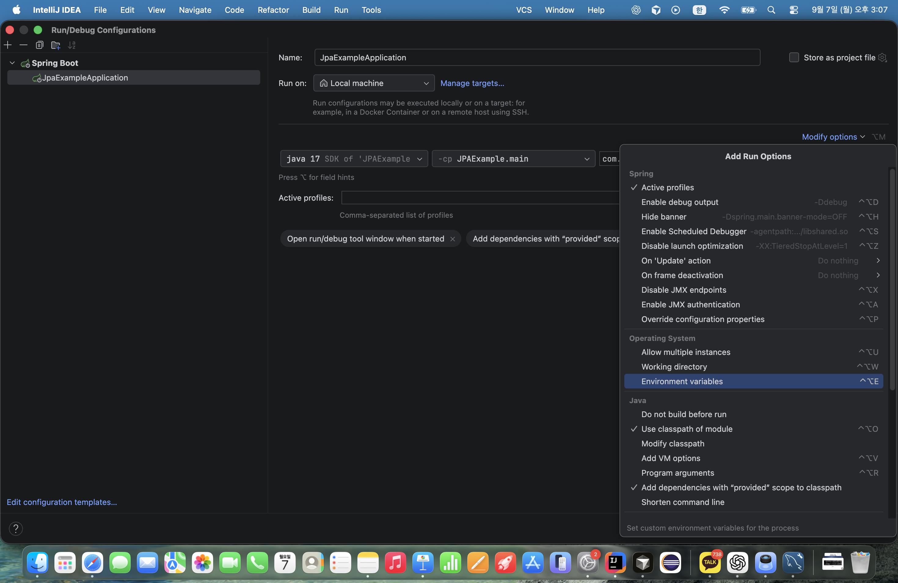

생긴 칸의 오른쪽 아이콘을 눌러줍니다

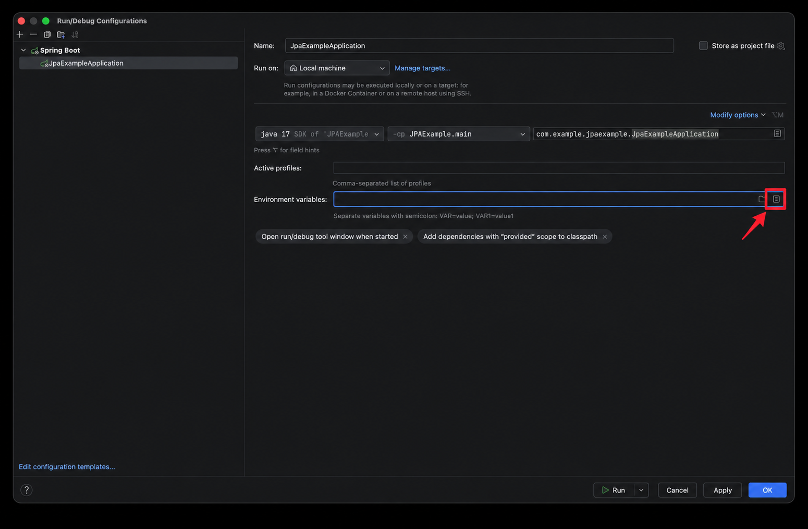

`+`를 눌러서 `application.yml`에 적었던 `${}` 세개를 이름으로 넣고, 값을 채워줍니다

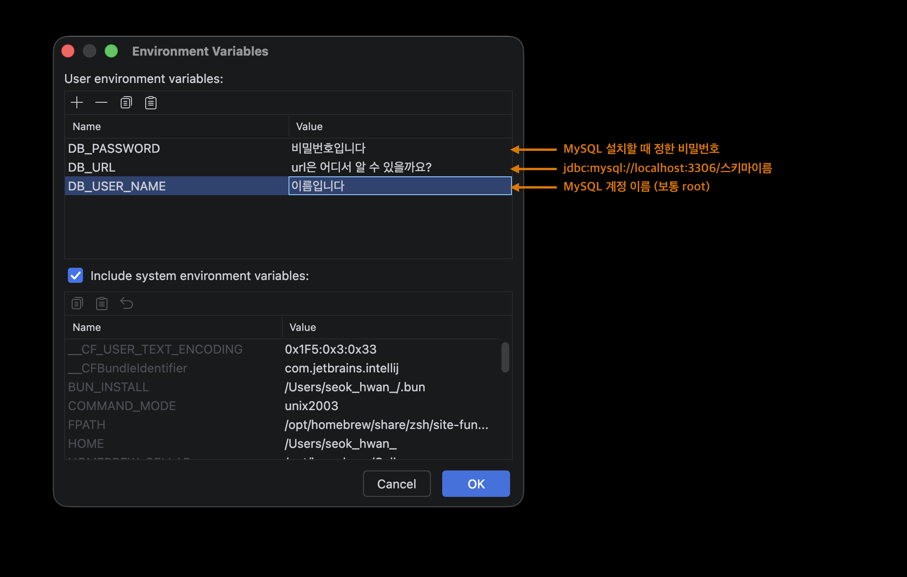

**다 넣었으면** `Apply`**를 꼭 누르고** `OK`**로 닫아주셔야 합니다**

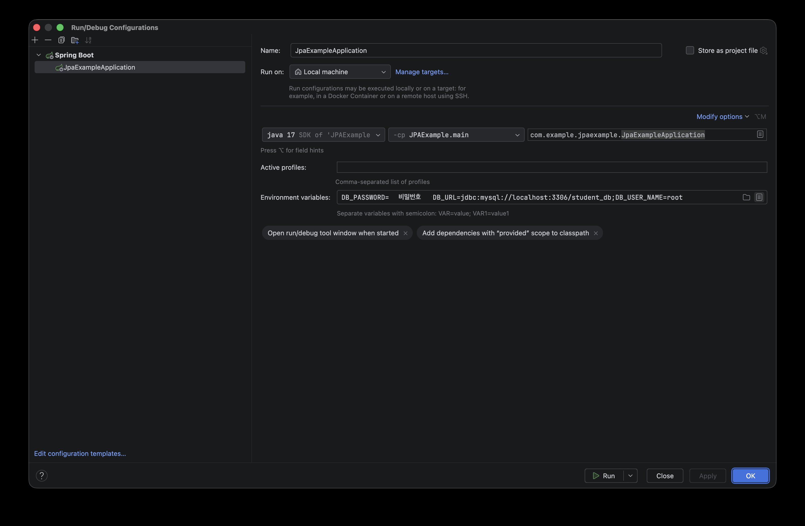

## 최종 구조

여기까지 하면 프로젝트와 `application.yml`이 이런 모습이 됩니다

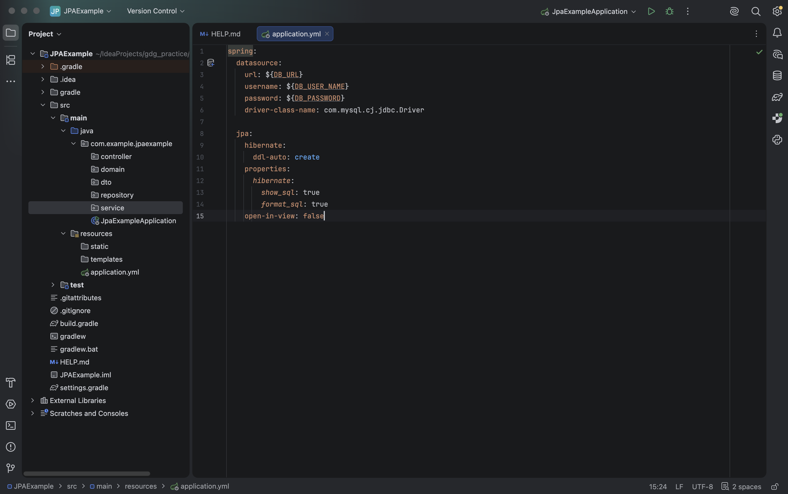

---


# 코드 작성해보기

학생과 강의를 등록하고, 학생 정보를 조회·수정·삭제하는 기능을 만들어보겠습니다


| 클래스       | 가지고 있는 값                        |
| --------- | ------------------------------- |
| `Course`  | `id`, `courseName`, `professor` |
| `Student` | `id`, `name`, `major`           |


강의 하나에는 학생이 여러명 들어갈 수 있으니, 강의(One)와 학생(Many)의 관계가 됩니다

**그래서 외래키인** `course_id`**는 학생 쪽이 들고있게 되고,** `Student`**가** `@ManyToOne`**,** `Course`**가** `@OneToMany`**를 가집니다**

## Domain 만들기

$\color{#9A6A3A}\textsf{Course.java}$

```java
@Entity
@Getter
@NoArgsConstructor
public class Course {

    @Id
    @GeneratedValue(strategy = GenerationType.IDENTITY)
    private Long id;

    @Column(nullable = false)
    private String courseName;

    private String professor;

    @OneToMany(mappedBy = "course", fetch = FetchType.LAZY, cascade = CascadeType.ALL, orphanRemoval = true)
    private List<Student> students = new ArrayList<>();

    @Builder
    public Course(String courseName, String professor) {
        this.courseName = courseName;
        this.professor = professor;
    }
}
```

강의 하나가 학생 여러명을 가지고 있으니 `@OneToMany`입니다

`courseName`은 카멜케이스라서 DB에는 `course_name` 열로 만들어집니다

```java
@OneToMany(mappedBy = "course", fetch = FetchType.LAZY, cascade = CascadeType.ALL, orphanRemoval = true)
```

`@OneToMany` 괄호 안에 옵션이 여러개 붙어있는데 하나씩 보겠습니다

$\color{#9A6A3A}\textsf{fetch = FetchType.LAZY}$

`fetch`는 연관된 객체를 언제 DB에서 가져올지 정하는 옵션입니다

`FetchType.LAZY`는 지연 로딩이라고 해서, 강의를 조회할 때 학생 목록은 바로 가져오지 않고 실제로 꺼내서 쓰는 순간에 쿼리를 날립니다

반대인 `FetchType.EAGER`는 강의를 조회하는 순간 학생 목록까지 한번에 같이 가져옵니다

`EAGER`로 두면 쓰지도 않는 데이터까지 매번 같이 끌고와서 쿼리가 생각보다 많이 나갈 수 있습니다

그래서 보통은 전부 `LAZY`로 두고, 같이 필요할 때만 따로 가져오는 방식을 많이 씁니다

`@OneToMany`는 기본값이 `LAZY`라서 사실 안 적어도 되지만, `@ManyToOne`은 기본값이 `EAGER`라서 `Student`쪽에는 꼭 적어줘야 합니다

$\color{#9A6A3A}\textsf{cascade = CascadeType.ALL}$

`cascade`는 부모 엔티티에 한 작업을 자식 엔티티에도 그대로 전달하는 옵션입니다

`CascadeType.ALL`이면 강의를 저장하거나 삭제할 때 그 강의에 들어있는 학생들도 같이 저장되거나 삭제됩니다

강의를 지우면 그 강의를 듣는 학생들도 같이 지워진다는 점은 꼭 알아두셔야 합니다

$\color{#9A6A3A}\textsf{orphanRemoval = true}$

`orphanRemoval`은 부모와의 연결이 끊어진 자식을 자동으로 지워주는 옵션입니다

뒤에서 만들 Service 코드를 변형해서 예시를 들어보겠습니다

```java
@Transactional
public void removeStudentFromCourse(Long courseId) {
    Course course = courseRepository.findById(courseId).orElseThrow(); // 강의를 DB에서 꺼내옵니다
    Student student = course.getStudents().get(0);                     // 그 강의의 첫번째 학생

    course.getStudents().remove(student);                              // 강의의 학생 목록에서 빼기만 합니다
}
```

`findById()`는 `id`로 DB에서 데이터를 꺼내오는 메서드이고, `@Transactional`은 이 메서드 안의 작업을 하나로 묶어주는 어노테이션입니다

코드를 보시면 학생을 삭제하는 코드는 한줄도 없고, 강의의 학생 목록에서 빼기만 한걸 볼 수 있습니다

이렇게 부모를 잃은 자식을 고아(orphan)라고 부르고, `orphanRemoval = true`가 붙어있으면 메서드가 끝날 때 JPA가 `DELETE` 쿼리를 날려서 이 학생 행을 DB에서 알아서 지워줍니다

`cascade`는 부모가 삭제될 때 자식도 같이 지우는 거라면, `orphanRemoval`은 부모는 그대로 있고 관계만 끊겨도 자식을 지운다는 차이가 있습니다

`@NoArgsConstructor` 는 매개변수가 없는 생성자를 만들어줍니다

`@Getter`는 `getName()`, `getMajor()` 같은 메서드가 자동으로 만들어집니다

$\color{#9A6A3A}\textsf{@Builder}$

`@Builder`는 객체를 만들 때 생성자 대신 필드 이름을 하나씩 적어가며 만들 수 있게 해주는 Lombok 어노테이션입니다

```java
// 생성자로 만들 때
new Student("김석환", "컴퓨터공학과", course);

// 빌더로 만들 때
Student.builder()
        .name("김석환")
        .major("컴퓨터공학과")
        .course(course)
        .build();
```

생성자로 만들면 매개변수 순서를 외워야 하고, 둘다 `String`인 `name`과 `major`의 순서가 바뀌어도 컴파일오류가 나지 않습니다

빌더는 어떤 값이 어디에 들어가는지 이름이 보이니까 이런 실수를 줄일 수 있습니다

여기서는 `@Builder`를 클래스가 아니라 생성자 위에 붙였는데, 이렇게 하면 생성자 매개변수에 있는 값만 빌더로 넣을 수 있습니다

$\color{#9A6A3A}\textsf{Student.java}$

```java
@Entity
@Getter
@NoArgsConstructor
public class Student {

    @Id
    @GeneratedValue(strategy = GenerationType.IDENTITY)
    private Long id;

    @Column(nullable = false)
    private String name;

    private String major;

    @ManyToOne(fetch = FetchType.LAZY)
    @JoinColumn(name = "course_id")
    private Course course;

    @Builder
    public Student(String name, String major, Course course) {
        this.name = name;
        this.major = major;
        this.course = course;
    }

    public void update(String name, String major, Course course) {
        this.name = name;
        this.major = major;
        this.course = course;
    }
}
```

학생 여러명이 강의 하나를 바라보고 있으니 `@ManyToOne`이고, `@JoinColumn`에 적은 `course_id`가 실제 테이블에 만들어지는 외래키 열입니다

## Repository 만들기

`repository` 패키지에 인터페이스 두개를 만들어줍니다

```java
public interface CourseRepository extends JpaRepository<Course, Long> {
}
```

```java
public interface StudentRepository extends JpaRepository<Student, Long> {
}
```

`JpaRepository`를 상속받기만 하면 `save`, `findById`, `findAll`, `deleteById` 같은 메서드를 알아서 만들어줍니다

## DTO 만들기

`dto` 패키지에, 요청을 받을 DTO와 응답을 내보낼 DTO를 만들어줍니다

$\color{#9A6A3A}\textsf{Course DTO}$

```java
@Getter
public class CourseSaveRequestDto {
    private String courseName;
    private String professor;
}
```

```java
@Builder
@Getter
public class CourseInfoResponseDto {
    private Long id;
    private String courseName;
    private String professor;

    public static CourseInfoResponseDto from(Course course) {
        return CourseInfoResponseDto.builder()
                .id(course.getId())
                .courseName(course.getCourseName())
                .professor(course.getProfessor())
                .build();
    }
}
```

`from()`은 `Course` 객체를 응답용 DTO로 바꿔주는 메서드입니다

$\color{#9A6A3A}\textsf{Student DTO}$

```java
@Getter
public class StudentSaveRequestDto {
    private Long courseId;
    private String name;
    private String major;
}
```

```java
@Builder
@Getter
public class StudentInfoResponseDto {
    private Long id;
    private String name;
    private String major;
    private Long courseId;
    private String courseName;

    public static StudentInfoResponseDto from(Student student) {
        return StudentInfoResponseDto.builder()
                .id(student.getId())
                .name(student.getName())
                .major(student.getMajor())
                .courseId(student.getCourse().getId())
                .courseName(student.getCourse().getCourseName())
                .build();
    }
}
```

학생을 등록할 때는 강의를 `id`로만 받고, 응답할 때는 강의 이름까지 같이 꺼내서 보내줍니다

## Service 만들기

`service` 패키지에 실제로 일을 하는 클래스를 만들어줍니다

$\color{#9A6A3A}\textsf{CourseService.java}$

```java
@Service
@RequiredArgsConstructor
public class CourseService {

    private final CourseRepository courseRepository;

    @Transactional
    public CourseInfoResponseDto saveCourse(CourseSaveRequestDto courseSaveRequestDto) {
        Course course = Course.builder()
                .courseName(courseSaveRequestDto.getCourseName())
                .professor(courseSaveRequestDto.getProfessor())
                .build();

        courseRepository.save(course);

        return CourseInfoResponseDto.from(course);
    }

    @Transactional
    public void deleteCourse(Long courseId) {
        courseRepository.deleteById(courseId);
    }

    @Transactional(readOnly = true)
    public List<CourseInfoResponseDto> getAllCourse() {
        return courseRepository.findAll()
                .stream()
                .map(CourseInfoResponseDto::from)
                .toList();
    }
}
```

`@Service`는 이 클래스가 실제 로직을 처리하는 Service라는걸 Spring에게 알려주고, Bean으로 등록해줍니다

`@RequiredArgsConstructor`는 지난번에 봤을텐데요. `final`이 붙은 필드를 매개변수로 받는 생성자를 만들어주는 Lombok 어노테이션입니다

그래서 `courseRepository`를 직접 `new`로 만들지 않아도 Spring이 생성자를 통해 알아서 넣어줍니다

$\color{#9A6A3A}\textsf{saveCourse()}$

요청으로 받은 DTO에서 값을 꺼내 `Course.builder()`로 엔티티를 만들고, `save()`로 DB에 저장합니다

`save()`를 부르는 순간 `course` 테이블에 행이 하나 늘어나기 때문에, `course`에는 DB가 매겨준 `id`가 바로 채워집니다

저장한 엔티티는 그대로 내보내지 않고, `from()`으로 응답용 DTO로 바꿔서 돌려주는걸 볼 수 있습니다

$\color{#9A6A3A}\textsf{deleteCourse()}$

`deleteById()`로 해당 `id`의 강의를 지웁니다

앞에서 본 `cascade = CascadeType.ALL` 때문에 이 강의에 들어있던 학생들도 같이 지워집니다

$\color{#9A6A3A}\textsf{getAllCourse()}$

`findAll()`로 모든 강의를 꺼내온 다음, `stream()`으로 하나씩 흘려보내면서 `map()`으로 DTO로 바꾸고 `toList()`로 다시 리스트로 모아줍니다

$\color{#9A6A3A}\textsf{StudentService.java}$

```java
@Service
@RequiredArgsConstructor
public class StudentService {

    private final StudentRepository studentRepository;
    private final CourseRepository courseRepository;

    @Transactional
    public StudentInfoResponseDto saveStudent(StudentSaveRequestDto studentSaveRequestDto) {
        Course course = courseRepository.findById(studentSaveRequestDto.getCourseId())
                .orElseThrow(() -> new IllegalArgumentException("존재하지 않는 강의입니다."));

        Student student = Student.builder()
                .name(studentSaveRequestDto.getName())
                .major(studentSaveRequestDto.getMajor())
                .course(course)
                .build();

        studentRepository.save(student);

        return StudentInfoResponseDto.from(student);
    }

    @Transactional(readOnly = true)
    public StudentInfoResponseDto getStudent(Long studentId) {
        Student student = studentRepository.findById(studentId)
                .orElseThrow(() -> new IllegalArgumentException("요청하신 학생 정보를 찾을 수 없습니다."));

        return StudentInfoResponseDto.from(student);
    }

    @Transactional
    public StudentInfoResponseDto updateStudent(Long studentId, StudentSaveRequestDto studentSaveRequestDto) {
        Student student = studentRepository.findById(studentId)
                .orElseThrow(() -> new IllegalArgumentException("요청하신 학생 정보를 찾을 수 없습니다."));

        Course course = courseRepository.findById(studentSaveRequestDto.getCourseId())
                .orElseThrow(() -> new IllegalArgumentException("존재하지 않는 강의입니다."));

        student.update(studentSaveRequestDto.getName(),
                studentSaveRequestDto.getMajor(),
                course);

        return StudentInfoResponseDto.from(student);
    }

    @Transactional
    public void deleteStudent(Long studentId) {
        studentRepository.deleteById(studentId);
    }

    @Transactional(readOnly = true)
    public List<StudentInfoResponseDto> getAllStudent() {
        return studentRepository.findAll()
                .stream()
                .map(StudentInfoResponseDto::from)
                .toList();
    }
}
```

`StudentService`는 학생을 저장할 때 강의도 찾아야 하니까 `CourseRepository`까지 같이 받아옵니다

$\color{#9A6A3A}\textsf{saveStudent()}$

요청에 담겨온 `courseId`로 강의를 먼저 찾고, 없으면 `orElseThrow()`로 `존재하지 않는 강의입니다.` 예외를 던집니다

`findById()`로 값을 찾아서 넘겨주는데, 없을 수도 있어서 `Optional`에 감싸서 넘겨줍니다

`orElseThrow()`는 값이 있으면 꺼내주고, 없으면 괄호 안의 예외를 던지는 메서드입니다

강의를 찾았으면 학생을 만들 때 `.course(course)`로 강의 객체를 통째로 넣어줍니다

그런데 테이블에는 객체를 통째로 넣을 수 없으니, JPA가 그 강의의 `id`만 꺼내서 `course_id` 열에 넣어줍니다

즉, 자바에서는 객체를 넣고, DB에는 그 객체의 id가 저장된다고 보시면 됩니다

$\color{#9A6A3A}\textsf{getStudent()}$

`id`로 학생 한명을 찾아서 DTO로 바꿔 돌려줍니다

$\color{#9A6A3A}\textsf{updateStudent()}$

여기서 `updateStudent`를 보시면 `student.update(...)`만 해주고 `save`를 하지 않았습니다

`@Transactional` 안에서 조회한 엔티티는 JPA가 지켜보고 있다가, 값이 바뀌면 트랜잭션이 끝날 때 알아서 `UPDATE` 쿼리를 날려줍니다

이걸 변경 감지(Dirty Checking)라고 합니다

$\color{#9A6A3A}\textsf{deleteStudent()}$

`deleteById()`로 학생 한명만 지웁니다

학생은 자식 쪽이라 학생을 지워도 강의는 그대로 남아있습니다

$\color{#9A6A3A}\textsf{getAllStudent()}$

`getAllCourse`와 같은 방식으로, 모든 학생을 꺼내와서 DTO 리스트로 바꿔 돌려줍니다

`@Transactional`은 중간에 오류가 나면 지금까지 한 작업을 전부 되돌려주고, `readOnly = true`는 조회만 할 때 붙여서 성능을 조금 아껴줍니다

## Controller 만들기

`controller` 패키지에 요청을 받아주는 클래스를 만들어줍니다

$\color{#9A6A3A}\textsf{CourseController.java}$

```java
@RestController
@RequiredArgsConstructor
@RequestMapping("/courses")
public class CourseController {

    private final CourseService courseService;

    @PostMapping
    public ResponseEntity<CourseInfoResponseDto> saveCourse(@RequestBody CourseSaveRequestDto courseSaveRequestDto) {
        return ResponseEntity.status(HttpStatus.CREATED).body(courseService.saveCourse(courseSaveRequestDto));
    }

    @DeleteMapping("/{courseId}")
    public ResponseEntity<Void> deleteCourse(@PathVariable Long courseId) {
        courseService.deleteCourse(courseId);
        return ResponseEntity.status(HttpStatus.NO_CONTENT).build();
    }

    @GetMapping
    public ResponseEntity<List<CourseInfoResponseDto>> getAllCourse() {
        return ResponseEntity.status(HttpStatus.OK).body(courseService.getAllCourse());
    }
}
```

`@RestController`는 이 클래스가 요청을 받아서 JSON으로 응답해주는 Controller라는걸 Spring에게 알려줍니다

`@RequestMapping("/courses")`를 클래스 위에 붙여두면, 안에 있는 메서드들의 주소는 전부 `/courses`로 시작하게 됩니다

`@RequiredArgsConstructor`는 Service때와 마찬가지로 `courseService`를 생성자로 넣어받기 위해 붙여줍니다

`ResponseEntity`는 응답 데이터와 함께 상태 코드까지 직접 정해서 보낼 수 있게 해주는 클래스입니다

$\color{#9A6A3A}\textsf{saveCourse()}$

`POST /courses`로 요청이 오면 실행됩니다

`@RequestBody`가 요청에 담겨온 JSON을 `CourseSaveRequestDto`로 바꿔주고, 이걸 그대로 `courseService.saveCourse()`에 넘겨줍니다

응답에는 DB가 매겨준 `id`까지 같이 담겨서 돌아옵니다

새로 만들어졌다는 뜻으로 `201 CREATED` 상태 코드를 같이 보내줍니다

$\color{#9A6A3A}\textsf{deleteCourse()}$

`DELETE /courses/1`처럼 주소 끝에 지울 강의의 `id`를 붙여서 요청합니다

`@PathVariable`이 주소의 `{courseId}` 자리에 있는 `1`을 꺼내서 `courseId`에 넣어줍니다

지우고 나면 돌려줄 데이터가 없으니 `ResponseEntity<Void>`로 두고, `204 NO_CONTENT`와 함께 빈 응답을 보냅니다

$\color{#9A6A3A}\textsf{getAllCourse()}$

`GET /courses`로 요청이 오면 모든 강의 목록을 `200 OK`와 함께 돌려줍니다

$\color{#9A6A3A}\textsf{StudentController.java}$

```java
@RestController
@RequiredArgsConstructor
@RequestMapping("/students")
public class StudentController {

    private final StudentService studentService;

    @PostMapping
    public ResponseEntity<StudentInfoResponseDto> saveStudent(@RequestBody StudentSaveRequestDto studentSaveRequestDto) {
        return ResponseEntity.status(HttpStatus.CREATED).body(studentService.saveStudent(studentSaveRequestDto));
    }

    @GetMapping("/{studentId}")
    public ResponseEntity<StudentInfoResponseDto> getStudent(@PathVariable Long studentId) {
        return ResponseEntity.status(HttpStatus.OK).body(studentService.getStudent(studentId));
    }

    @PatchMapping("/{studentId}")
    public ResponseEntity<StudentInfoResponseDto> updateStudent(@PathVariable Long studentId,
                                                                @RequestBody StudentSaveRequestDto studentSaveRequestDto) {
        return ResponseEntity.status(HttpStatus.OK).body(studentService.updateStudent(studentId, studentSaveRequestDto));
    }

    @DeleteMapping("/{studentId}")
    public ResponseEntity<Void> deleteStudent(@PathVariable Long studentId) {
        studentService.deleteStudent(studentId);
        return ResponseEntity.status(HttpStatus.NO_CONTENT).build();
    }

    @GetMapping
    public ResponseEntity<List<StudentInfoResponseDto>> getAllStudent() {
        return ResponseEntity.status(HttpStatus.OK).body(studentService.getAllStudent());
    }
}
```

`StudentController`도 구조는 똑같고, 주소만 `/students`로 시작합니다

## 포스트맨으로 테스트하기

저번이랑 동일하게 `+` 누르고 `Collection` 누르기

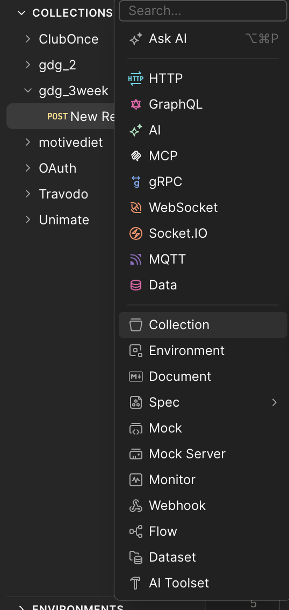

`rename` 눌러서 이름을 `JPAExample` 로 바꾸기

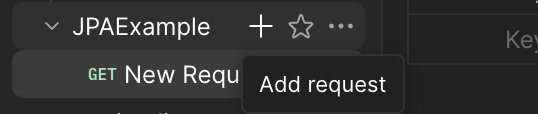

`+` 누르기

직접 쳐보시는게 좋을거같아서 복사코드가 없습니다 ㅎㅎ

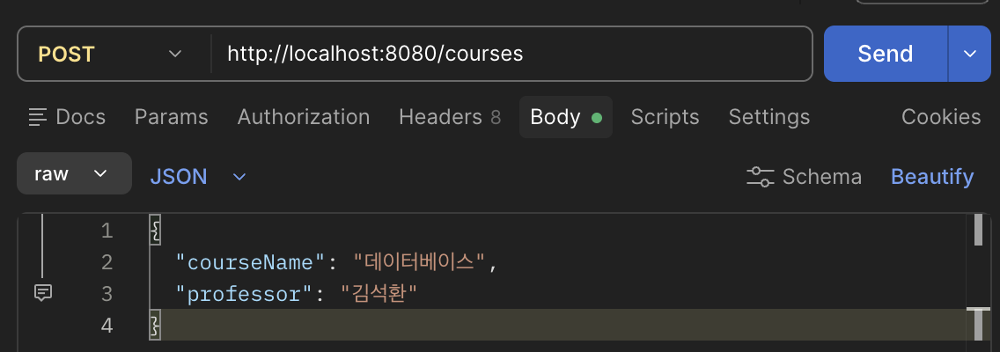

아래와 같이 나오면 됩니다

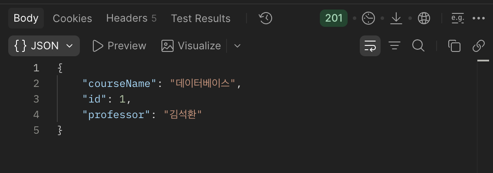

추가한 강의가 잘 등록이 됐는지 확인을 합니다


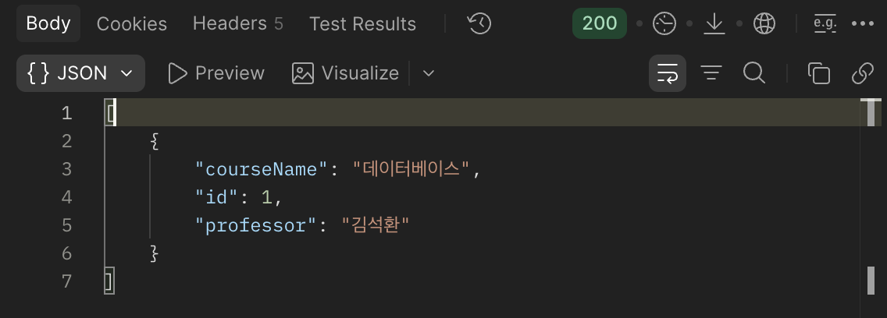

`courseId` 는 `@GeneratedValue(strategy = GenerationType.IDENTITY)`로 자동 생성된 id의 값을 넣어주면 되겠죠?

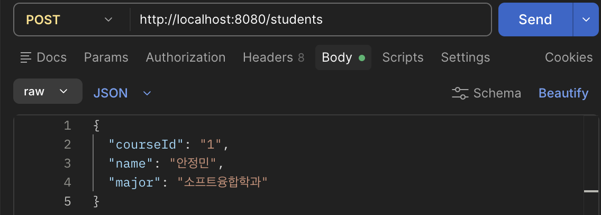

아래와 같이 나옵니다

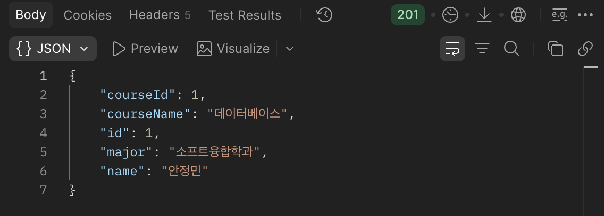

방금 만든 학생에 대한 정보를 조회해보겠습니다. 안정민 학생이 `id`가 1이었기 때문에 `students/1` 로 요청합니다


아래와 같이 나오면 됩니다


안정민 학생을 이길수 학생으로 이름 변경해보겠습니다.

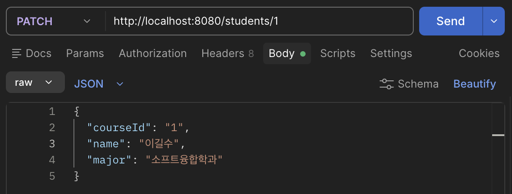

아래와 같이 바뀐걸 확인할 수 있습니다

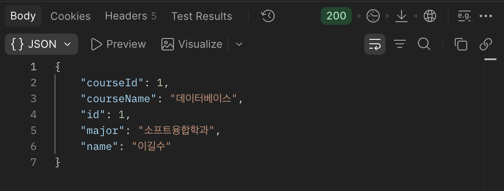

이번에도 학생에 대해 조회해볼건데 전체 학생을 조회하기 위해서 url 마지막에 `id`를 넣지 않았습니다


바뀐걸 확인할 수 있습니다

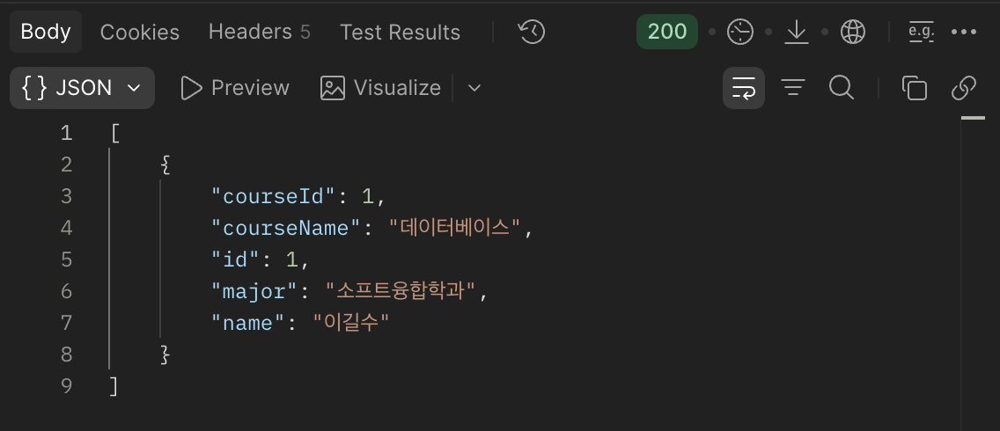

`cascade` 엔티티에서 `cascade = CascadeType.ALL` 라고 설정을 해놨기 때문에 만약, `courses/1`을 삭제하게 된다면 해당 `courses`에 소속된 `students` 들은 전부 제거가 됩니다!

그래서 학생을 먼저 지우고, 그다음에 강의를 지워보겠습니다

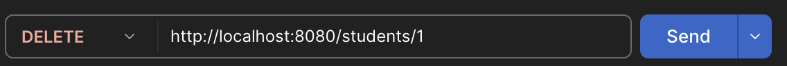

다음에 `courses`를 삭제해주시면 됩니다!

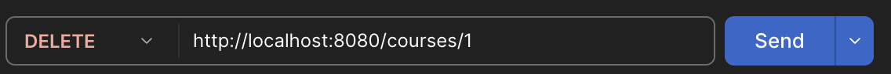

마지막으로 전부 다 삭제가 잘 됐는지 확인해보시면 됩니다 

따라오시느라 고생하셨습니다...!! 😂